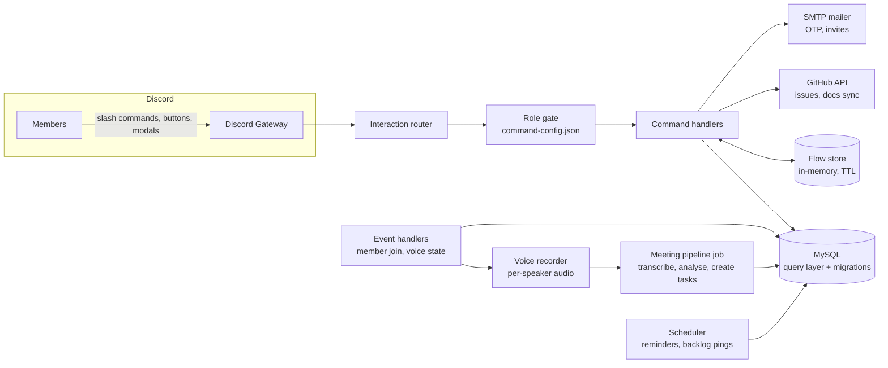

# DevHouse Discord Bot

[](https://github.com/Aashir-Adnan/devhouse-discord-bot/actions)


An operations bot that runs a software team's Discord server end to end: **email verification, role approval, bug and feature tickets with private channels, meeting scheduling and recording, FAQs, and a leadership dashboard**. Every command is a multi-step flow built from embeds, select menus, buttons and modals.

> **About this repository.** This is the public showcase edition of a bot I designed and built for a software house. The production source is private, so this repo contains the architecture write-up, command reference, data model, and a **runnable, token-free demo** of the core behaviours (verification, role gating, multi-step flows, ticket lifecycle) with tests. No Discord account or database is needed to try it.

## Try it in 10 seconds

```bash
git clone https://github.com/Aashir-Adnan/devhouse-discord-bot.git
cd devhouse-discord-bot
npm run demo   # walks a new member from join to closed ticket
npm test       # 14 tests
```

Sample output (full transcript in [docs/demo-walkthrough.md](docs/demo-walkthrough.md)):

```
== 3. Role gate: a Holding member cannot approve themselves
bot      x /approve requires one of: CEO, Server Manager

== 4. /approve by CEO: Holding -> Verified + roles
bot      newcomer now has [Verified,Junior Dev]
```

## Features

| Area | What it does |
|---|---|
| **Onboarding** | New members land in a *Holding* role and see only the onboarding channel. `/verify` emails a 6-digit OTP restricted to allowed domains; admins then approve with `/approve` or `/backlog`. |
| **Role-based access** | Allowed roles per command live in config, not code. Unconfigured commands are denied by default. |
| **Tickets** | `/bug` and `/feature` open a **private channel** for the assigner and assignees, create a doc stub, and optionally a GitHub issue. `/resolve-bug` / `/close-feature` take an attached Markdown write-up and save it as documentation. Daily DM reminders cover open tickets. |
| **Tasks dashboard** | `/dashboard` groups tasks by module with type, handler, status, API/QA/acceptance results, and dependencies (blocked state is computed, not stored). |
| **Meetings** | `/schedule` with natural-language times and per-guild timezones; voice meetings are recorded per speaker, transcribed, analysed, and turned into tasks assigned to Discord users. |
| **Docs and Q&A** | `/docs` browses and searches Markdown synced from repositories; `/explain` answers questions from the synced project docs; `/faq` collects and answers team questions. |
| **Admin tooling** | `/init` builds roles, categories and channels in one click; `/scrap` resets cleanly; `/evaluate` summarises a member's bugs, features and commits; `/clock-in` and `/clock-out` track time. |

Full list: [docs/commands.md](docs/commands.md).

## Architecture



Details, including why each piece exists, are in [docs/architecture.md](docs/architecture.md).

### Design decisions worth reading

- **Stateless interactions, stateful flows.** Each click or modal submit is a separate event, so in-progress answers live in a flow store keyed by `user:guild:command` with a TTL. See [`demo/flowStore.js`](demo/flowStore.js).
- **Permissions as data.** One JSON map decides who can run what; the gate denies by default. See [`demo/gates.js`](demo/gates.js).
- **Own data layer.** A small SQL abstraction (connection manager, transaction manager, query builder) with a Prisma-style call surface and numbered SQL migrations, so features add tables without touching connection code.
- **Tests never touch production.** Commands receive their `db` and `getConfig` seams so tests inject fakes; a written rule forbids tests that can reach a real database.
- **Computed, not stored.** Task "blocked" state is derived from dependencies at read time, so it cannot drift.

## Repository layout

```
demo/            runnable simulator of the bot's core behaviours
  flowStore.js   TTL step-state store for multi-step flows
  gates.js       data-driven role gate (deny by default)
  guild.js       in-memory model: join -> verify -> approve -> tickets
  simulator.js   scripted walkthrough (npm run demo)
test/            node:test suites for the above
docs/            architecture, commands, data model, security, demo transcript
.env.example     placeholder configuration for a real deployment
```

## Running a real instance

The demo needs nothing. A real deployment needs a Discord application, MySQL, and an SMTP account. Placeholders are in [.env.example](.env.example); the setup checklist (privileged intents, `applications.commands` scope, guild-scoped command registration for fast iteration) is in [docs/architecture.md#deployment-checklist](docs/architecture.md#deployment-checklist).

## Tech stack

Node.js (ESM), discord.js v14, `@discordjs/voice` with Opus/ffmpeg, MySQL, Nodemailer, GitHub REST API, GitHub Actions. Tests use the built-in `node:test` runner.

## Author

**Aashir Adnan** · [GitHub](https://github.com/Aashir-Adnan) · Licensed under [MIT](LICENSE).
