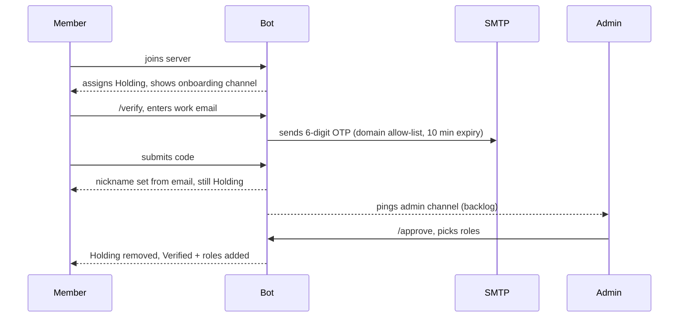
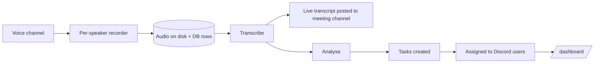

# Architecture

## Request lifecycle

1. **Gateway event.** discord.js delivers a slash command, button press, select-menu choice, or modal submit.
2. **Interaction router** (`handlers/interactions`) dispatches by type and custom ID to the owning command module.
3. **Role gate.** The command name is checked against `command-config.json`. Server owners and members with Manage Server pass; otherwise one of the configured roles is required. Unknown commands are denied.
4. **Command handler** reads or writes the **flow store** for multi-step state, talks to MySQL through the data layer, and replies with the next embed and components.
5. **Side effects** (create a private channel, send an email, open a GitHub issue, DM a reminder) run after the database write succeeds.

## Multi-step flows

A command such as `/feature` spans several interactions:

```
modal (title, description) -> select repo/project -> select assignees -> [Create ticket]
```

Each step stores its answer in the flow store under `userId:guildId:command` and renders the next step. Confirming reads the accumulated answers, writes the records, and clears the flow. Entries expire after 30 minutes so abandoned flows do not leak memory. A confirm with missing answers fails closed (see the `incomplete` test).

## Data layer

```
ConnectionManager   pool lifecycle
TransactionManager  begin/commit/rollback helper
QueryBuilder        parameterised SQL generation
SchemaAdapter       maps table/column names to the call surface
db.<model>.create/findMany/update   Prisma-style API used by commands
migrations/NNN_*.sql  numbered, applied in order, tracked in schema_migrations
```

Migrations are plain SQL files applied by a runner that records each in `schema_migrations`, so a fresh database and an upgraded one converge on the same schema.

## Verification



## Meeting pipeline



Recording is per speaker so utterances can be attributed and ordered without diarisation. Pipeline stages are tracked as jobs in the database, so a failed stage can be retried without re-recording. Recordings are never committed to version control.

## Deployment checklist

1. Create a Discord application and bot user.
2. Enable the **Server Members** intent (member lists, verification, approval) and, only if a feature reads message text, **Message Content**. Without the required intents the bot exits at login.
3. Invite with the `bot` and **`applications.commands`** scopes; otherwise slash commands never appear.
4. Set `DISCORD_GUILD_ID` while developing and register commands guild-scoped for instant updates; register globally for production.
5. Provision MySQL, copy `.env.example` to `.env`, run the schema and migrations.
6. Run `/init` once in the target server. Run `/scrap` first if the server was already initialised.
