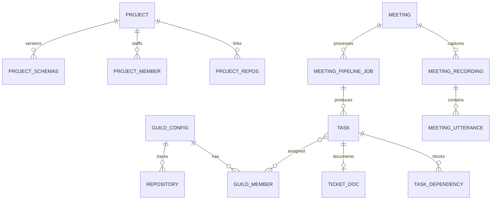

# Data model (overview)

The schema is grouped by concern. Table and column details are intentionally summarised here.

| Concern | Tables |
|---|---|
| Server setup | guild config, assignable roles, scopes, modules |
| People | guild member, verification OTP, pending invite, email log, clock entries |
| Work | task (unified bugs and features), task dependency, ticket doc, bug comments, project, project members |
| Projects | repositories, project schemas, schema dump versions |
| Meetings | scheduled meeting, meeting channel and messages, recording and status, pipeline job, utterances |
| Knowledge | doc source, doc page, FAQ |
| Ops | schema_migrations |

**Unified task model.** Bugs and features share one `task` table with a type column plus optional fields (handler, scope, implementation status, API/QA/acceptance results). Fields are nullable when irrelevant, which keeps the dashboard query and the meeting pipeline simple.
